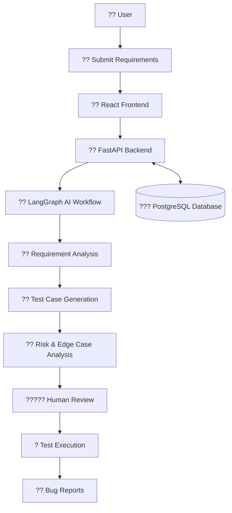
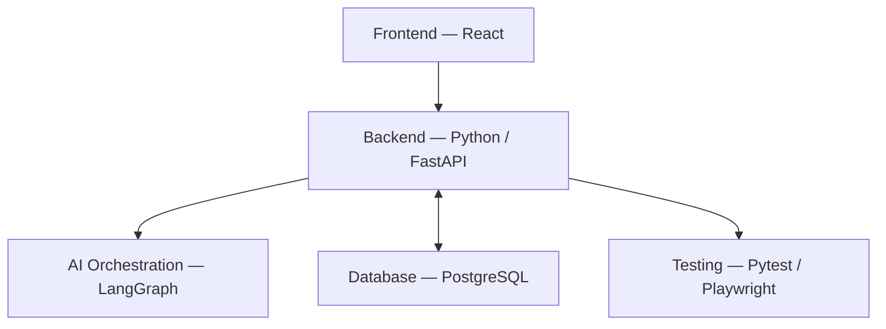
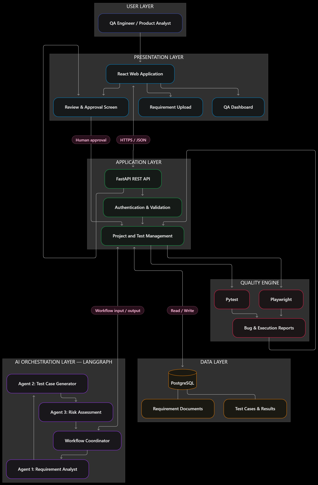
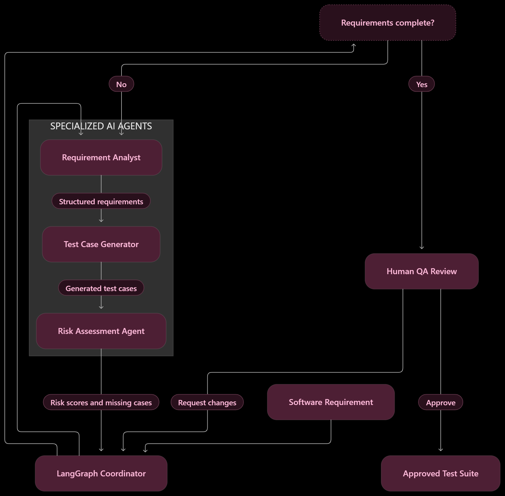
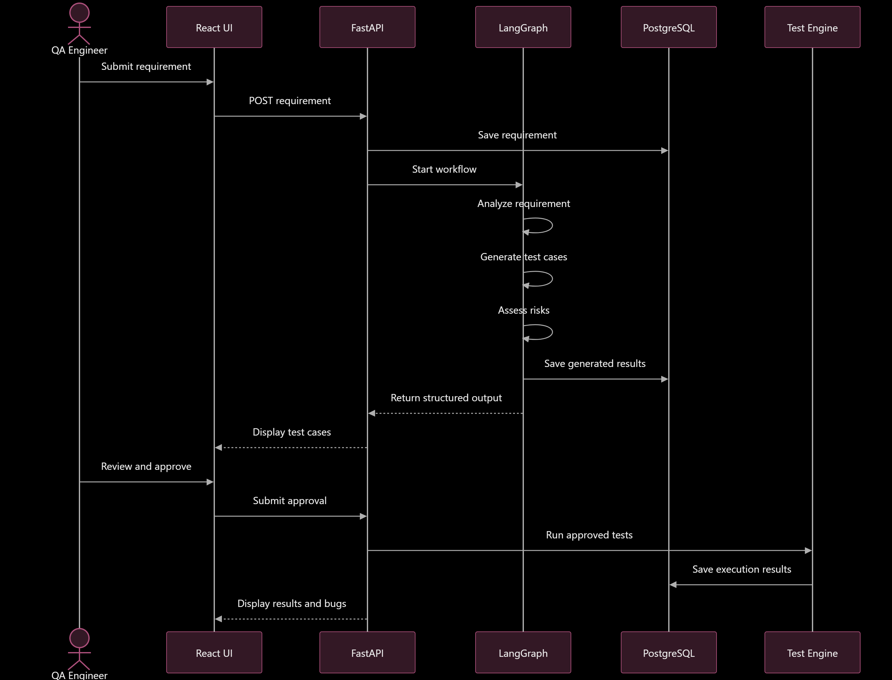

# Spec2Test AI — Architecture

## System Overview

## Technology Layers

*Note: This is the planned architecture, not an implemented system.*

## Architecture Visuals

### System Architecture

### Multi-Agent Architecture

### Requirement Data Flow

## Architecture Visuals

### System Architecture

### Multi-Agent Architecture

### Requirement Data Flow

