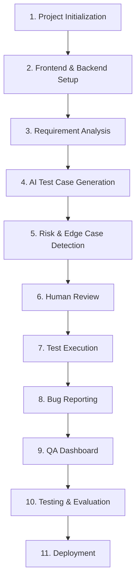

# Spec2Test AI — Project Plan

## Development Workflow

## Main Objectives

- Convert software requirements into test cases.
- Identify missing scenarios and risks.
- Allow manual review of AI-generated results.
- Help QA teams manage testing and bug reports.

## Current Status

Project initialization and planning only.
